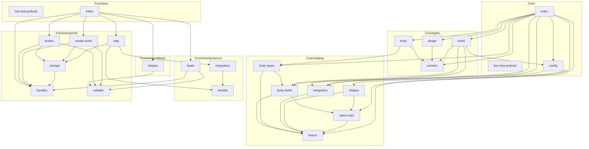

<!-- repo-map:no-verification -->
<!-- GENERATED FILE -- do not edit by hand.
     Regenerate with `repo-tools map`. -->

# physjs - Dependency Graph

**Version**: 0.0.0

This document provides a comprehensive dependency graph of all files, components, imports, functions, and variables in the codebase.

---

## Table of Contents

1. [Overview](#overview)
2. [Package Dependencies](#package-dependencies)
3. [Core Dependencies](#core-dependencies)
4. [Core/catalog Dependencies](#core-catalog-dependencies)
5. [Core/types Dependencies](#core-types-dependencies)
6. [Functions Dependencies](#functions-dependencies)
7. [Functions/collision Dependencies](#functions-collision-dependencies)
8. [Functions/dynamics Dependencies](#functions-dynamics-dependencies)
9. [Functions/world Dependencies](#functions-world-dependencies)
10. [Dependency Matrix](#dependency-matrix)
11. [Circular Dependency Analysis](#circular-dependency-analysis)
12. [Visual Dependency Graph](#visual-dependency-graph)
13. [Summary Statistics](#summary-statistics)

---

<a id="overview"></a>
## Overview

The codebase is organized into the following modules:

- **core**: 3 files
- **core/catalog**: 6 files
- **core/types**: 4 files
- **functions**: 2 files
- **functions/collision**: 1 file
- **functions/dynamics**: 3 files
- **functions/world**: 6 files

---

<a id="core-dependencies"></a>

## Core Dependencies

### `core/bun-test-preload.ts` - Mirrors the build-time `define` from tsdown.config.ts for tests that import source.

**Node.js Built-in Dependencies:**
| Module | Import |
|--------|--------|
| `fs` | `readFileSync` |

---

### `core/src/config.ts` - World defaults. Physical constants are not defined here: default gravity is

**Internal Dependencies:**
| File | Imports | Type |
|------|---------|------|
| `./catalog/freeze` | `deepFreeze` | Import |
| `./catalog/integrators` | `IntegratorName` | Import (type-only) |

**Exports:**
- Interfaces: `WorldDefaults`
- Types: `SupportedDims`
- Constants: `SUPPORTED_DIMS`, `WORLD_DEFAULTS`

---

### `core/src/index.ts` - Core types, data catalogs and configuration for PhysJS. Units, constants and

**Internal Dependencies:**
| File | Imports | Type |
|------|---------|------|
| `./catalog/body-fields` | `BODY_FIELDS` | Re-export |
| `./catalog/body-fields` | `BodyFieldName, BodyFieldRecord, BodyFieldRole, DescriptorFieldName` | Re-export (type-only) |
| `./catalog/body-types` | `BODY_TYPES` | Re-export |
| `./catalog/body-types` | `BodyTypeName, BodyTypeRecord` | Re-export (type-only) |
| `./catalog/integrators` | `INTEGRATOR_CATALOG` | Re-export |
| `./catalog/integrators` | `IntegratorName, IntegratorRecord` | Re-export (type-only) |
| `./catalog/shapes` | `SHAPES` | Re-export |
| `./catalog/shapes` | `ShapeParamRecord, ShapeRecord, ShapeType` | Re-export (type-only) |
| `./catalog/value-rules` | `VALUE_RULES` | Re-export |
| `./catalog/value-rules` | `ValueRule, ValueRuleRecord` | Re-export (type-only) |
| `./config` | `SUPPORTED_DIMS, WORLD_DEFAULTS` | Re-export |
| `./config` | `SupportedDims, WorldDefaults` | Re-export (type-only) |
| `./types/body` | `BodyDescriptor, BodyHandle` | Re-export (type-only) |
| `./types/numeric` | `NumericInput, NumericOutput` | Re-export (type-only) |
| `./types/shape` | `BoxShape, CapsuleShape, ShapeDescriptor, SphereShape` | Re-export (type-only) |
| `./types/world` | `BodyStore, World, WorldOptions` | Re-export (type-only) |

**Exports:**
- Constants: `PACKAGE_NAME`, `VERSION`
- Re-exports:

  ```text
  BODY_FIELDS, BodyFieldName, BodyFieldRecord, BodyFieldRole, DescriptorFieldName, BODY_TYPES,
  BodyTypeName, BodyTypeRecord, INTEGRATOR_CATALOG, IntegratorName, IntegratorRecord, SHAPES,
  ShapeParamRecord, ShapeRecord, ShapeType, VALUE_RULES, ValueRule, ValueRuleRecord, SUPPORTED_DIMS,
  WORLD_DEFAULTS, SupportedDims, WorldDefaults, BodyDescriptor, BodyHandle, NumericInput,
  NumericOutput, BoxShape, CapsuleShape, ShapeDescriptor, SphereShape, BodyStore, World, WorldOptions
  ```


---

<a id="core-catalog-dependencies"></a>

## Core/catalog Dependencies

### `core/src/catalog/body-fields.ts` - Per-body state, as data. Each record is one struct-of-arrays column in the

**Internal Dependencies:**
| File | Imports | Type |
|------|---------|------|
| `./freeze` | `deepFreeze` | Import |
| `./value-rules` | `ValueRule` | Import (type-only) |

**Exports:**
- Interfaces: `BodyFieldRecord`
- Types: `BodyFieldRole`, `BodyFieldName`, `DescriptorFieldName`
- Constants: `BODY_FIELDS`

---

### `core/src/catalog/body-types.ts` - The body types, as data. `step` and `addBody` read these flags; there is no

**Internal Dependencies:**
| File | Imports | Type |
|------|---------|------|
| `./body-fields` | `DescriptorFieldName` | Import (type-only) |
| `./freeze` | `deepFreeze` | Import |

**Exports:**
- Interfaces: `BodyTypeRecord`
- Types: `BodyTypeName`
- Constants: `BODY_TYPES`

---

### `core/src/catalog/freeze.ts` - freeze module

**Exports:**
- Functions: `deepFreeze`

---

### `core/src/catalog/integrators.ts` - The integrators PhysJS implements, as data. `@danielsimonjr/physjs` keys its

**Internal Dependencies:**
| File | Imports | Type |
|------|---------|------|
| `./freeze` | `deepFreeze` | Import |

**Exports:**
- Interfaces: `IntegratorRecord`
- Types: `IntegratorName`
- Constants: `INTEGRATOR_CATALOG`

---

### `core/src/catalog/shapes.ts` - Collision shapes, as data: one record per shape type with its parameter

**Internal Dependencies:**
| File | Imports | Type |
|------|---------|------|
| `./freeze` | `deepFreeze` | Import |
| `./value-rules` | `ValueRule` | Import (type-only) |

**Exports:**
- Interfaces: `ShapeParamRecord`, `ShapeRecord`
- Types: `ShapeType`
- Constants: `SHAPES`

---

### `core/src/catalog/value-rules.ts` - The number rules that catalog fields and shape parameters name. One table, so

**Internal Dependencies:**
| File | Imports | Type |
|------|---------|------|
| `./freeze` | `deepFreeze` | Import |

**Exports:**
- Interfaces: `ValueRuleRecord`
- Types: `ValueRule`
- Constants: `VALUE_RULES`

---

<a id="core-types-dependencies"></a>

## Core/types Dependencies

### `core/src/types/body.ts` - Body records. Field names follow fourJS's `RigidBodyDescriptor` so the fourJS

**Internal Dependencies:**
| File | Imports | Type |
|------|---------|------|
| `../catalog/body-types` | `BodyTypeName` | Import (type-only) |
| `./numeric` | `NumericInput` | Import (type-only) |

**Exports:**
- Interfaces: `BodyDescriptor`
- Types: `BodyHandle`

---

### `core/src/types/numeric.ts` - Type definitions (1 interfaces, 1 type aliases)

**Exports:**
- Interfaces: `NumericOutput`
- Types: `NumericInput`

---

### `core/src/types/shape.ts` - Type definitions (3 interfaces, 1 type aliases)

**Internal Dependencies:**
| File | Imports | Type |
|------|---------|------|
| `./numeric` | `NumericInput` | Import (type-only) |

**Exports:**
- Interfaces: `SphereShape`, `BoxShape`, `CapsuleShape`
- Types: `ShapeDescriptor`

---

### `core/src/types/world.ts` - World records. A world is plain data: typed-array columns generated from

**Internal Dependencies:**
| File | Imports | Type |
|------|---------|------|
| `../catalog/body-fields` | `BodyFieldName` | Import (type-only) |
| `../catalog/integrators` | `IntegratorName` | Import (type-only) |
| `../config` | `SupportedDims` | Import (type-only) |
| `./numeric` | `NumericInput` | Import (type-only) |

**Exports:**
- Interfaces: `WorldOptions`, `BodyStore`, `World`

---

<a id="functions-dependencies"></a>

## Functions Dependencies

### `functions/bun-test-preload.ts` - Mirrors the build-time `define` from tsdown.config.ts for tests that import source.

**Node.js Built-in Dependencies:**
| Module | Import |
|--------|--------|
| `fs` | `readFileSync` |

---

### `functions/src/index.ts` - The public PhysJS package: worlds, bodies, applied loads and integration.

**Workspace Dependencies:**
| Package | Import |
|---------|--------|
| `@danielsimonjr/physjs-core` | `BODY_FIELDS, BODY_TYPES, INTEGRATOR_CATALOG, PACKAGE_NAME, SHAPES, SUPPORTED_DIMS, VALUE_RULES, VERSION, WORLD_DEFAULTS` |
| `@danielsimonjr/physjs-core` | `BodyDescriptor, BodyHandle, BodyTypeName, BoxShape, CapsuleShape, IntegratorName, NumericInput, NumericOutput, ShapeDescriptor, SphereShape, World, WorldOptions` |

**Internal Dependencies:**
| File | Imports | Type |
|------|---------|------|
| `./collision/shapes` | `validateShape` | Re-export |
| `./dynamics/loads` | `applyForce, applyTorque` | Re-export |
| `./dynamics/loads` | `LoadAdder` | Re-export (type-only) |
| `./world/bodies` | `addBody, bodyCount, getAngularVelocity, getBodyType, getLinearVelocity, getMass, getPosition, getRotation, hasBody, removeBody, setAngularVelocity, setLinearVelocity, setPosition, setRotation` | Re-export |
| `./world/bodies` | `FieldGetter, FieldSetter` | Re-export (type-only) |
| `./world/create-world` | `createWorld` | Re-export |
| `./world/handles` | `MAX_BODIES` | Re-export |
| `./world/step` | `step` | Re-export |

**Exports:**
- Constants: `PACKAGE_NAME`, `VERSION`
- Re-exports:

  ```text
  BODY_FIELDS, BODY_TYPES, INTEGRATOR_CATALOG, CORE_PACKAGE_NAME, SHAPES, SUPPORTED_DIMS, VALUE_RULES,
  CORE_VERSION, WORLD_DEFAULTS, BodyDescriptor, BodyHandle, BodyTypeName, BoxShape, CapsuleShape,
  IntegratorName, NumericInput, NumericOutput, ShapeDescriptor, SphereShape, World, WorldOptions,
  validateShape, applyForce, applyTorque, LoadAdder, addBody, bodyCount, getAngularVelocity,
  getBodyType, getLinearVelocity, getMass, getPosition, getRotation, hasBody, removeBody,
  setAngularVelocity, setLinearVelocity, setPosition, setRotation, FieldGetter, FieldSetter,
  createWorld, MAX_BODIES, step
  ```


---

<a id="functions-collision-dependencies"></a>

## Functions/collision Dependencies

### `functions/src/collision/shapes.ts` - Checks a shape against its `SHAPES` row: a known type, exactly that row's

**Workspace Dependencies:**
| Package | Import |
|---------|--------|
| `@danielsimonjr/physjs-core` | `SHAPES, ShapeDescriptor, ShapeRecord` |

**Internal Dependencies:**
| File | Imports | Type |
|------|---------|------|
| `../world/validate` | `readValue, rejectUnknownKeys, requireRecord` | Import |

**Exports:**
- Functions: `validateShape`

---

<a id="functions-dynamics-dependencies"></a>

## Functions/dynamics Dependencies

### `functions/src/dynamics/integrators.ts` - Integrator functions, keyed by the `INTEGRATOR_CATALOG` names. The type of

**External Dependencies:**
| Package | Import |
|---------|--------|
| `@danielsimonjr/mathts-functions` | `quaternionExp, quaternionMultiply, quaternionNormalize` |

**Workspace Dependencies:**
| Package | Import |
|---------|--------|
| `@danielsimonjr/physjs-core` | `BODY_FIELDS, BodyStore, IntegratorName` |

**Internal Dependencies:**
| File | Imports | Type |
|------|---------|------|
| `./sample` | `SAMPLE_LAYOUT` | Import |

**Exports:**
- Types: `IntegratorFn`
- Constants: `INTEGRATORS`

---

### `functions/src/dynamics/loads.ts` - Applied loads. Each accumulator column of `BODY_FIELDS` gets one adder; the

**Workspace Dependencies:**
| Package | Import |
|---------|--------|
| `@danielsimonjr/physjs-core` | `BODY_FIELDS, BodyFieldName, BodyHandle, NumericInput, World` |

**Internal Dependencies:**
| File | Imports | Type |
|------|---------|------|
| `../world/handles` | `requireSlot` | Import |
| `../world/validate` | `readValue` | Import |

**Exports:**
- Types: `LoadAdder`
- Constants: `applyForce`, `applyTorque`

---

### `functions/src/dynamics/sample.ts` - The acceleration sample an integrator advances one body with: linear and

**External Dependencies:**
| Package | Import |
|---------|--------|
| `@danielsimonjr/mathts-functions` | `dotMultiply, quaternionConjugate, quaternionRotate` |

**Workspace Dependencies:**
| Package | Import |
|---------|--------|
| `@danielsimonjr/physjs-core` | `BODY_FIELDS, BodyTypeRecord, World` |

**Exports:**
- Functions: `loadSample`
- Constants: `SAMPLE_LAYOUT`

---

<a id="functions-world-dependencies"></a>

## Functions/world Dependencies

### `functions/src/world/bodies.ts` - Adding, removing and reading bodies. Descriptor checks, defaults and the

**External Dependencies:**
| Package | Import |
|---------|--------|
| `@danielsimonjr/mathts-functions` | `quaternionNormalize` |

**Workspace Dependencies:**
| Package | Import |
|---------|--------|
| `@danielsimonjr/physjs-core` | `BODY_FIELDS, BODY_TYPES, BodyDescriptor, BodyFieldName, BodyFieldRecord, BodyHandle, BodyTypeName, BodyTypeRecord, DescriptorFieldName, NumericInput, NumericOutput, World` |

**Internal Dependencies:**
| File | Imports | Type |
|------|---------|------|
| `./handles` | `packHandle, requireSlot, slotOf` | Import |
| `./storage` | `FIELD_NAMES, allocateSlot, readColumn, releaseSlot, writeColumn` | Import |
| `./validate` | `readValue, rejectUnknownKeys, requireRecord` | Import |

**Exports:**
- Interfaces: `FieldGetter`
- Types: `FieldSetter`
- Functions: `addBody`, `removeBody`, `hasBody`, `bodyCount`, `getBodyType`, `getMass`
- Constants: `getPosition`, `getRotation`, `getLinearVelocity`, `getAngularVelocity`, `setPosition`, `setRotation`, `setLinearVelocity`, `setAngularVelocity`

---

### `functions/src/world/create-world.ts` - Creates an empty world.

**External Dependencies:**
| Package | Import |
|---------|--------|
| `@danielsimonjr/mathts-functions` | `gravity` |

**Workspace Dependencies:**
| Package | Import |
|---------|--------|
| `@danielsimonjr/physjs-core` | `INTEGRATOR_CATALOG, SUPPORTED_DIMS, WORLD_DEFAULTS, World, WorldOptions` |

**Internal Dependencies:**
| File | Imports | Type |
|------|---------|------|
| `./handles` | `MAX_BODIES` | Import |
| `./storage` | `createBodyStore` | Import |
| `./validate` | `readValue, rejectUnknownKeys, requireRecord` | Import |

**Exports:**
- Functions: `createWorld`

---

### `functions/src/world/handles.ts` - Generation-tagged body handles. A handle packs a slot index and the slot's

**Workspace Dependencies:**
| Package | Import |
|---------|--------|
| `@danielsimonjr/physjs-core` | `BodyHandle, BodyStore` |

**Exports:**
- Functions: `packHandle`, `slotOf`, `requireSlot`
- Constants: `MAX_BODIES`, `GENERATION_LIMIT`

---

### `functions/src/world/step.ts` - Advances the world by `dt` seconds: every live body whose type integrates is

**Workspace Dependencies:**
| Package | Import |
|---------|--------|
| `@danielsimonjr/physjs-core` | `BODY_FIELDS, BODY_TYPES, VALUE_RULES, BodyTypeRecord, World` |

**Internal Dependencies:**
| File | Imports | Type |
|------|---------|------|
| `../dynamics/integrators` | `INTEGRATORS` | Import |
| `../dynamics/sample` | `SAMPLE_LAYOUT, loadSample` | Import |
| `./storage` | `FIELD_NAMES` | Import |

**Exports:**
- Functions: `step`

---

### `functions/src/world/storage.ts` - The struct-of-arrays body store. Every column, its size and its defaults come

**Workspace Dependencies:**
| Package | Import |
|---------|--------|
| `@danielsimonjr/physjs-core` | `BODY_FIELDS, BodyFieldName, BodyStore, NumericOutput` |

**Internal Dependencies:**
| File | Imports | Type |
|------|---------|------|
| `./handles` | `GENERATION_LIMIT, MAX_BODIES` | Import |

**Exports:**
- Functions: `createBodyStore`, `allocateSlot`, `releaseSlot`, `writeColumn`, `readColumn`
- Constants: `FIELD_NAMES`

---

### `functions/src/world/validate.ts` - Input checks shared by every PhysJS entry point. Schemas come from the core

**Workspace Dependencies:**
| Package | Import |
|---------|--------|
| `@danielsimonjr/physjs-core` | `VALUE_RULES, ValueRule` |

**Exports:**
- Interfaces: `ValueSchema`
- Functions: `readValue`, `requireRecord`, `rejectUnknownKeys`

---

<a id="dependency-matrix"></a>
## Dependency Matrix

### File Import/Export Matrix

| File | Imports From | Exports To |
|------|--------------|------------|
| `core/src/index` | 10 files | 0 files |
| `core/src/catalog/freeze` | 0 files | 6 files |
| `functions/src/index` | 6 files | 0 files |
| `core/src/catalog/body-fields` | 2 files | 3 files |
| `core/src/types/world` | 4 files | 1 file |
| `functions/src/world/handles` | 0 files | 5 files |
| `core/src/catalog/body-types` | 2 files | 2 files |
| `core/src/catalog/integrators` | 1 file | 3 files |
| `core/src/catalog/value-rules` | 1 file | 3 files |
| `core/src/config` | 2 files | 2 files |
| `core/src/types/numeric` | 0 files | 4 files |
| `functions/src/world/bodies` | 3 files | 1 file |
| `functions/src/world/create-world` | 3 files | 1 file |
| `functions/src/world/step` | 3 files | 1 file |
| `functions/src/world/storage` | 1 file | 3 files |
| `functions/src/world/validate` | 0 files | 4 files |
| `core/src/catalog/shapes` | 2 files | 1 file |
| `core/src/types/body` | 2 files | 1 file |
| `functions/src/dynamics/loads` | 2 files | 1 file |
| `core/src/types/shape` | 1 file | 1 file |
| `functions/src/collision/shapes` | 1 file | 1 file |
| `functions/src/dynamics/integrators` | 1 file | 1 file |
| `functions/src/dynamics/sample` | 0 files | 2 files |
| `core/bun-test-preload` | 0 files | 0 files |
| `functions/bun-test-preload` | 0 files | 0 files |

---

<a id="circular-dependency-analysis"></a>
## Circular Dependency Analysis

**No circular dependencies detected.**
---

<a id="visual-dependency-graph"></a>
## Visual Dependency Graph



---

<a id="summary-statistics"></a>
## Summary Statistics

| Category | Count |
|----------|-------|
| Total Source Files | 38 |
| Subsystems | 7 |
| Total Lines of Code | 2111 |
| Total Exports | 156 |
| Total Re-exports | 77 |
| Total Classes | 0 |
| Total Interfaces | 17 |
| Total Functions | 22 |
| Total Type Guards | 0 |
| Total Enums | 0 |
| Type-only Imports | 25 |
| Runtime Cyclic Components | 0 |
| Type-only Cyclic Components | 0 |
| Files in Runtime Cycles | 0 |
| Files in Type-only Cycles | 0 |

---

*Version*: 0.0.0
